

  

<h1 align="center">Argus</h1>

  <b>A hundred-eyed guardian for your Mac's network.</b> 
  See every connection every app makes. Decide what gets through. Block what you don't want.

  <a href="https://github.com/ceesco53/Argus/releases/latest"><b>Download</b></a> ·
  <a href="docs/FEATURES.md">All features</a> ·
  <a href="docs/BUILDING.md">Build from source</a> ·
  <a href="docs/COMMAND-LINE.md">Command line</a>

> [!WARNING]
> **Argus was vibe coded by Claude, an AI model, and comes with no warranty whatsoever. Its author takes
> no responsibility, legal or otherwise, for anything it does to your Mac, your network, your data or
> anything else.** Argus asks you to accept its [Disclaimer and Terms of Use](docs/TERMS.md) the first
> time it opens and will not run unless you do.

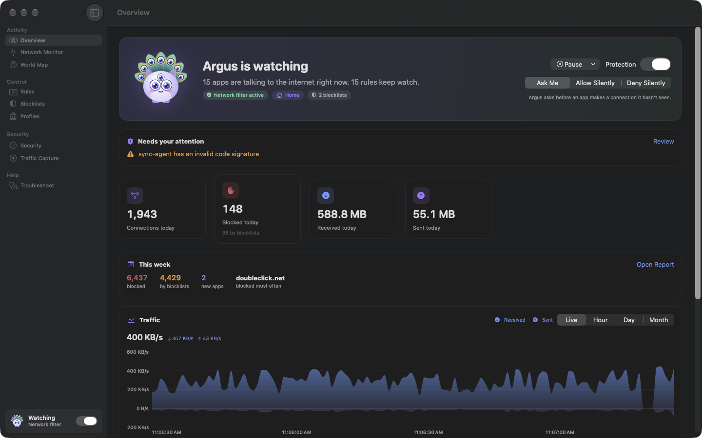

## Every connection, at a glance

Every app, every server, where it is and how much data moved, live. Group by app or by domain, filter to
what was blocked or what's new this week, and see Safari's web traffic under Safari, not a system helper.

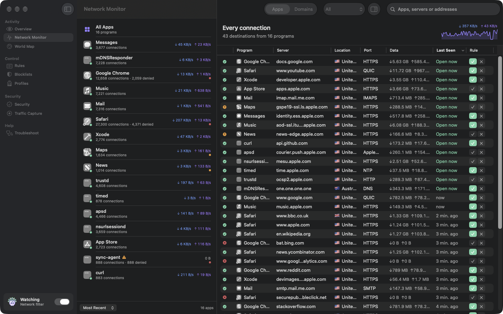

## Decide in one click

When an app tries something new, Argus holds the connection and asks, with a suggested answer and the
reasons behind it. Answer for one server or the whole domain, once or forever. Other apps' alerts wait
politely below, grouped so you can answer them together.

  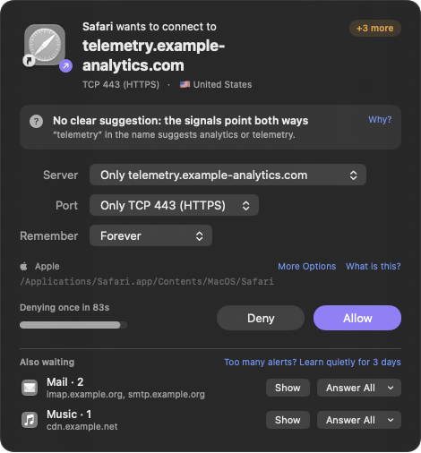

## See where your data goes

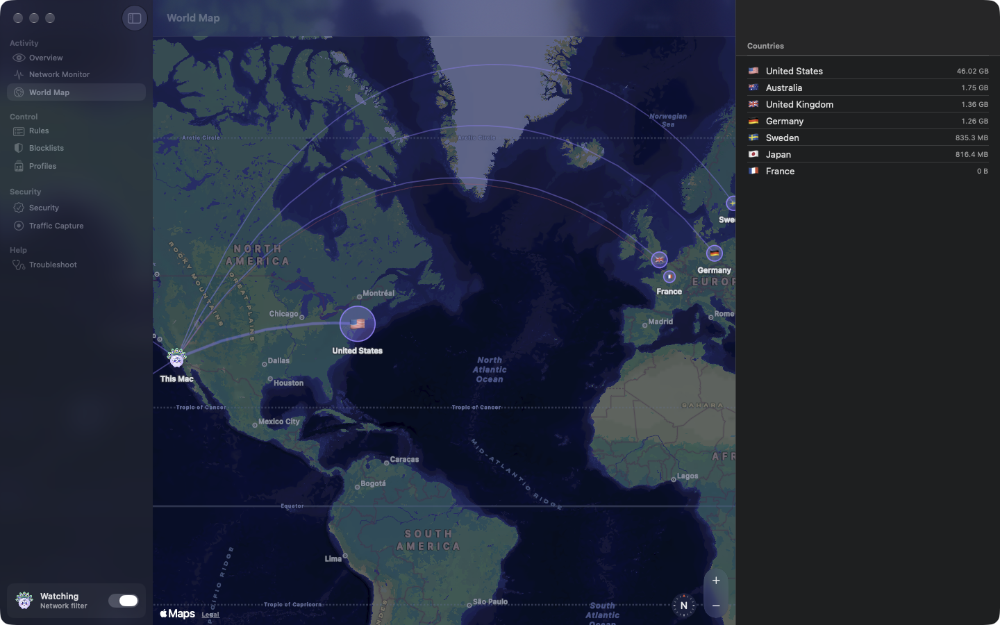

## Rules that read like sentences

Allow or deny by app, server, domain, network, port and protocol. Make rules temporary, give them
priority, or keep them to one profile. Duplicates and rules that can never apply are flagged, and every
change can be undone.

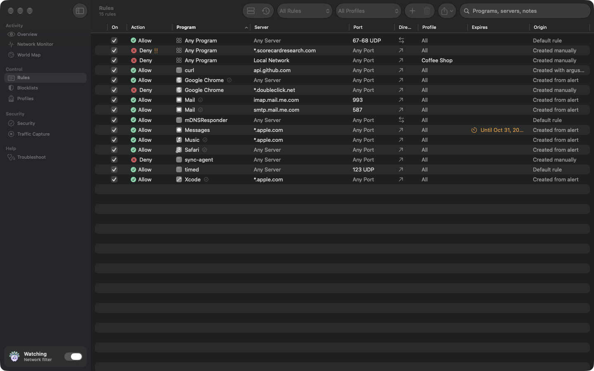

## Blocklists, one click away

Subscribe to the community's ad, tracker and malware lists from a built-in catalog, or any list by URL.
They refresh themselves, and never touch your own network.

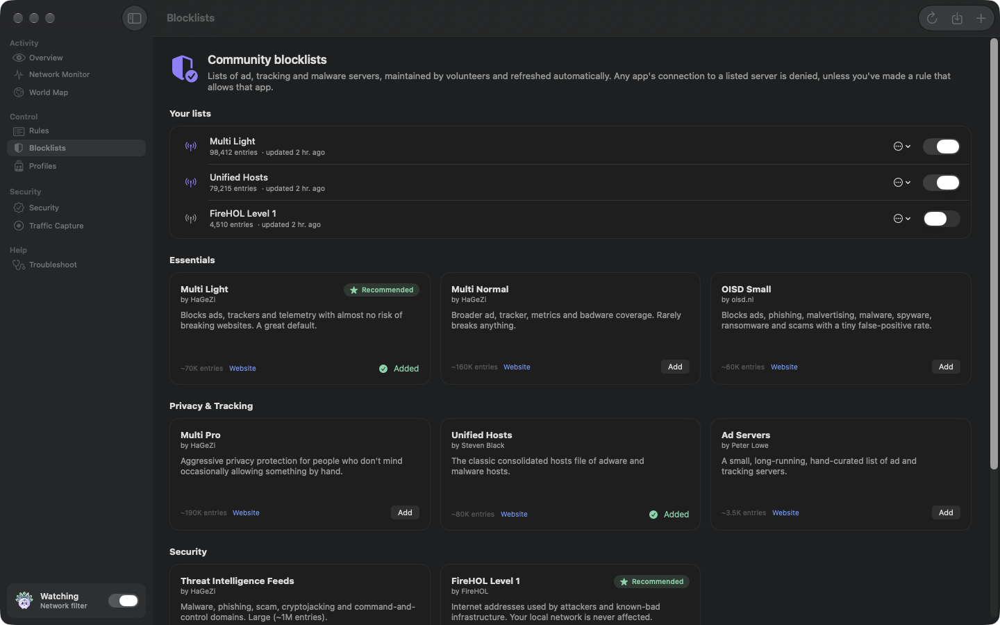

## Profiles that follow you

Home, Office, Coffee Shop: each with its own rules and mode, switched automatically when your Mac joins
one of its networks.

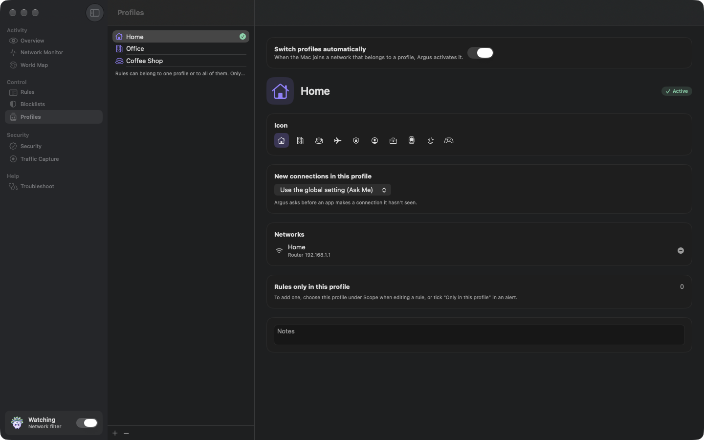

## Something not working?

Pick the app that's misbehaving: Argus shows what it blocked and why, and lets it through in one click.
Search anything, and Argus tells you straight away whether it's being blocked.

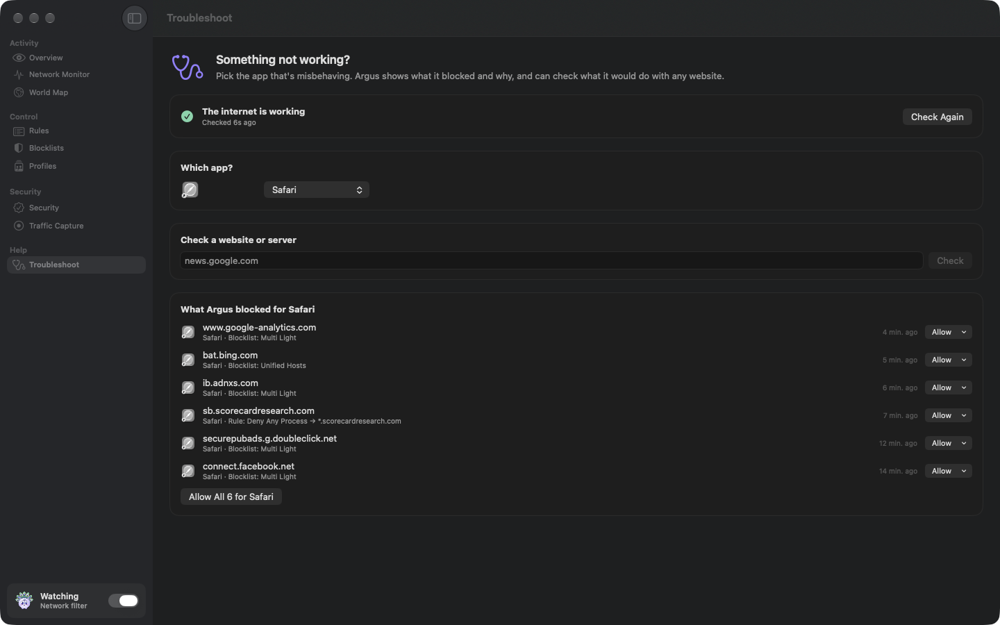

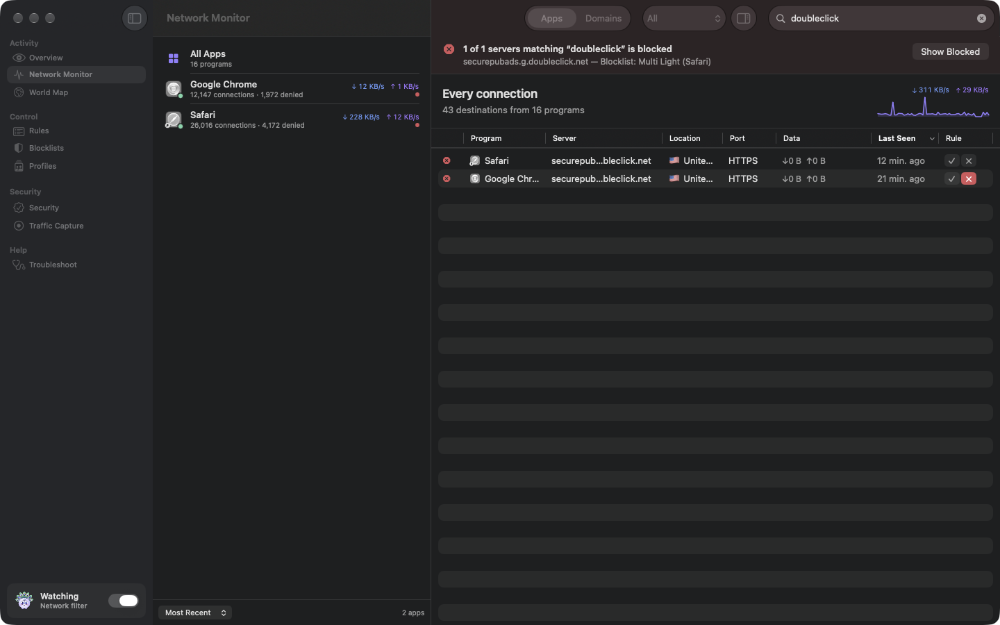

## Security that watches the watchers

Every program's code signature is checked when it connects, so a replaced or tampered app can't inherit
its rules. Argus also warns when something starts sniffing raw network traffic, and can lock its settings
behind an administrator password.

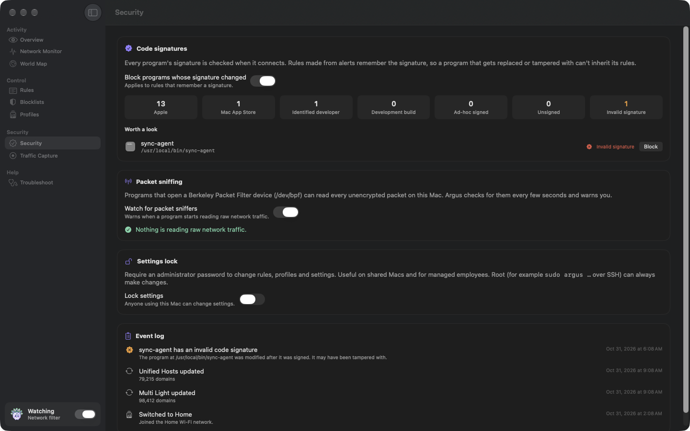

## A calm start, and a weekly look back

Start with a quiet learning period instead of a flood of alerts, then trust or block each app from one
review screen. Every week, a short report shows what was blocked and what's new.

  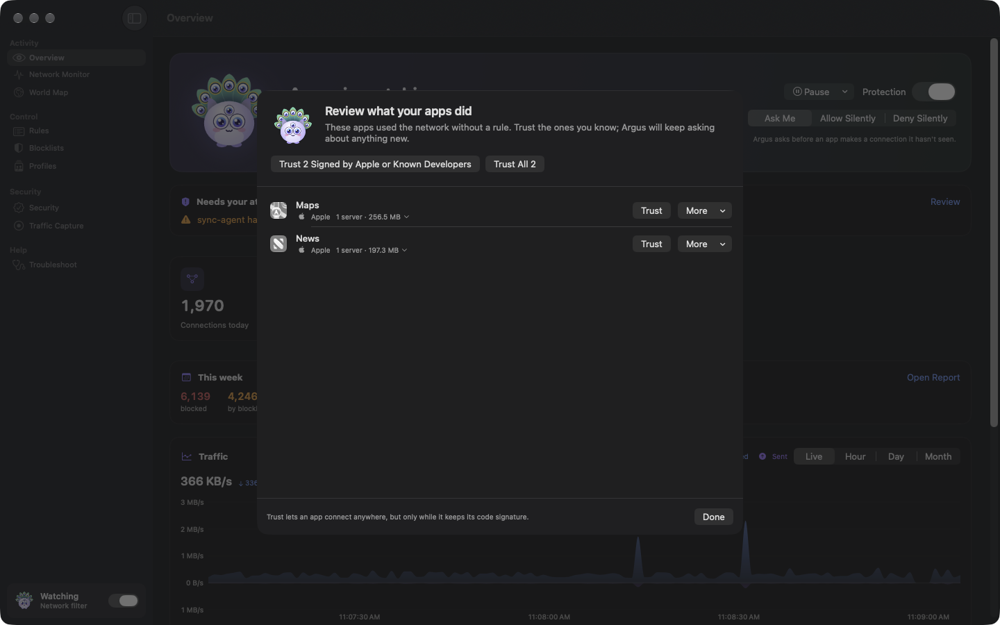
  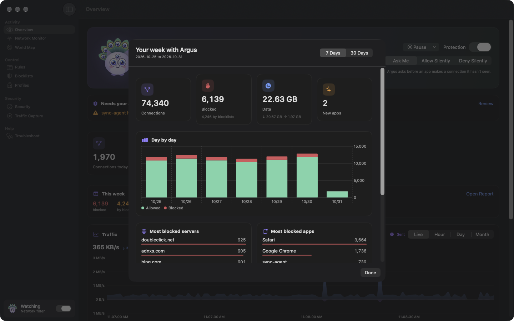

## Always in your menu bar

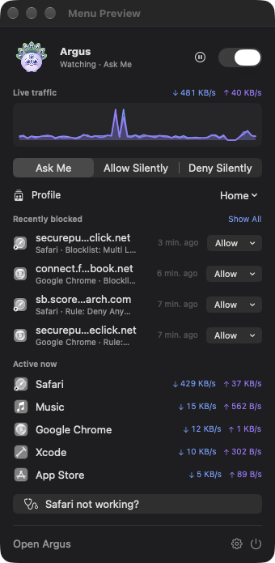

Live traffic, what was just blocked (allow it in one click), what's active right now, and the mode, all
from the menu bar. Pause protection for a few minutes from here, Control Center or Shortcuts.

And there's more:

- **Learns while you work**, and decides on its own during calls and while the screen is locked
- **Health checks** that say whether Argus is the cause, and step aside for hotel Wi-Fi sign-ins
- **Packet capture** to `.pcap` for Wireshark
- **Widgets**, **Control Center** controls and **Siri & Shortcuts** actions
- **iCloud sync** of rules between your Macs
- A **command line tool** for everything, usable over SSH
- **Automatic updates**, signed and notarized

 

See [everything Argus does](docs/FEATURES.md).

## Get Argus

**[Download the latest release](https://github.com/ceesco53/Argus/releases/latest)**, unzip it and move
Argus to your Applications folder. Requires macOS 15 or later.

The first time it opens, Argus asks you to accept its terms, then to install its network filter, which
macOS asks you to allow in System Settings › General › Login Items & Extensions.

Prefer to build it yourself? See [Building](docs/BUILDING.md).

## Documentation

| | |
|---|---|
| [Disclaimer and Terms of Use](docs/TERMS.md) | The terms you accept before Argus runs |
| [All features](docs/FEATURES.md) | Everything Argus does |
| [Building](docs/BUILDING.md) | Monitor mode and filter mode, building, enabling the network filter |
| [Command line](docs/COMMAND-LINE.md) | The `argus` tool |
| [Architecture](docs/ARCHITECTURE.md) | How it fits together, suggested answers, rule precedence |
| [Privacy](docs/PRIVACY.md) | What leaves your Mac (nothing about your connections) |
| [Known limitations](docs/LIMITATIONS.md) | What Argus can't do |
| [Development](docs/DEVELOPMENT.md) | Tests, debug options, demo mode, diagnosing the filter |
| [Releasing](docs/RELEASING.md) | Signing, notarizing and publishing updates |

## License

Argus is available under the [MIT License](LICENSE). Community blocklists and registry data are
downloaded at runtime from their maintainers and remain under their own licenses.

The screenshots show made-up activity from Argus's [demo mode](docs/DEVELOPMENT.md#demo-mode-and-the-readme-screenshots).
